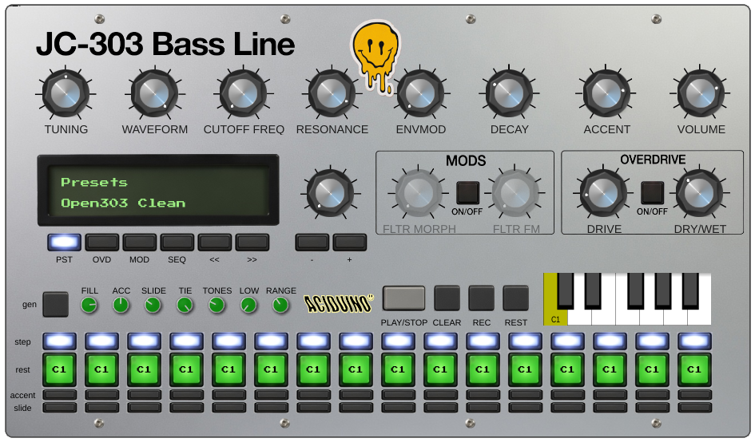

# JC-303 Plugin

This is a Free Roland TB-303 clone plugin. A Cmake JUCE port of [Robin Schmidt`s Open303](https://github.com/RobinSchmidt/Open303) with added features.



This software is licensed under the GNU General Public License version 3 (GPLv3).

The Open303 engine part of this software is also licensed under the MIT License.

### Licensing by file

- The project as a whole is distributed under GPLv3 (see `LICENSE`).
- `src/dsp/open303/rosic_*` and the other Open303 files are MIT, Copyright (c) 2009 Robin Schmidt (see `src/dsp/open303/LICENSE`).
- `src/dsp/open303/dfl_DiodeLadderFilter.*`, `src/dsp/open303/dfl_TB303OutputNetwork.h` and `src/dsp/open303/dfl_LFO.*` are AGPL-3.0-or-later, Copyright (C) 2026 David Lowenfels (see `LICENSE-AGPL-3.0`). Each file carries an SPDX header.

## Features

- **TB-303 engine** with the original Open303 voice, plus `Alpha Juno` and `Phaseshaper` oscillator models.
- **Eight filter models**: the TeeBee, Spicy, MissBehave, JuneBug, Wasabi, Hornet, SemiSweet and Oddity ladders/state-variable filters.
- **Four-slot modulation matrix**, each slot with its own source, destination and bipolar amount, plus a full LFO.
- **Built-in 16-step acid sequencer** with accent, slide, tie, mute, hammer and per-step reverse.
- **Overdrive** with modelled drive pedals/amps, separate drive and dry/wet, and pre-VCA routing.
- **Assignable mod knobs**, JSON presets and preset banks, and AnaMark `.tun` microtuning.

The manual below describes the `midilabv2` GUI theme (the default). The `amadeusp` and `midilab` themes drive the same engine with a different panel layout, so the parameter names are the same even where a control looks different.

## Download

Supports Windows, Linux and MacOS. You may find CLAP, VST3, LV2 and AU formats available to download. For VST2 plugin you need to compile it by your own self using vst2 sdk from Steinberg - vstsdk2.4.

MacOS Universal - Intel and ARM: [jc303-macos_universal-plugins.zip](https://github.com/midilab/jc303/releases/download/v0.13.0/jc303-0.13.0-macos_universal-plugins.zip)

Windows Intel x64: [jc303-windows_x64-plugins.zip](https://github.com/midilab/jc303/releases/download/v0.13.0/jc303-0.13.0-windows_x64-plugins.zip)

Linux Intel x64: [jc303-linux_x64-plugins.zip](https://github.com/midilab/jc303/releases/download/v0.13.0/jc303-0.13.0-linux_x64-plugins.zip)  

Linux ARM64: Soon...  

## Installation

The platform zip pack will contain a folder per plugin format, just pick the format you want to install and copy the content of the folder to your OS plugin format folder.

**MacOs De-Quarantine**: MacOs users needs to de-quarantine plugin before load it into any DAW.  
Open a terminal window and do the following
```shell
$ sudo xattr -rd com.apple.quarantine /Library/Audio/Plug-Ins/Components/JC303.component
```
This de-quarantine example is for AU, please do the same for other formats you'll be using

## Controls

### Main panel

| Control | What it does |
|--|--|
| `WAVEFORM` | Saw/square blend on the TB-303, `Alpha Juno` pulse morph, or `Phaseshaper` shape, depending on the oscillator model |
| `TUNING` | Master tune, roughly -700 to +700 cents; centre is A4 = 440 Hz. Right-click for the microtuning menu |
| `CUTOFF FREQ` | Filter cutoff |
| `RESONANCE` | Filter resonance |
| `ENVMOD` | Filter-envelope depth |
| `DECAY` | Filter-envelope (MEG) decay; its range changes with the `MOD` switch |
| `ACCENT` | Accent amount |
| `VOLUME` | Output level |
| `MOD` switch | Turns the modifications on or off |
| `DRIVE`, `DRY/WET` + switch | Overdrive |
| Two assignable knobs | Quick control of two `MOD`-page parameters (see [Mod knobs](#mod-knobs)) |

Everything the `MOD` switch controls is on the LCD `MOD` page (see [Modifications page](#modifications-page)); the panel itself carries only the controls listed above. With the `MOD` switch off the engine is a stock TB-303: TeeBee filter, TB-303 oscillator, Open303 square, no LFO, no sub oscillator and the fixed 303 envelopes. The `MOD` page and the assignable knobs are inactive in that state. Switch `MOD` on to use the oscillator models, the other filters, the LFO/mod matrix and the mod knobs.

### LCD menu

The display and the eight buttons under it are the menu:

- `PST`, `OVD`, `MOD`, `SEQ` select the Presets, Overdrive, Modifications and Sequencer pages. The editor opens on `PST`.
- `<<` and `>>` move the cursor between rows on the current page.
- `-` and `+` step the selected row's value one increment (choice entries step one item at a time).
- The large knob next to them sweeps the selected row's value.
- **Click a row's label** to open its picker: preset list, bank list, LFO waveform, filter model, oscillator model, modulation source/destination, and so on.
- Each page remembers its own cursor position when you switch pages.

`MOD`-page rows are greyed out and do nothing until the `MOD` switch is on. Rows that only apply to a particular filter or oscillator model are hidden while another model is selected, so the page stays short.

### Modifications page

The `MOD` page is the full list of modifications, in this order. Rows marked with a model only appear while that filter or oscillator model is selected.

| Row | What it does |
|--|--|
| `Filter Model` | Selects the filter (see [Filter models](#filter-models)) |
| `Filter Morph` | Low-pass (0) to band-pass (0.5) to high-pass (1); every model but `TeeBee` |
| `Res Trim` | Component-tolerance loop gain, 0.5 = nominal; `Spicy` only |
| `Filter Quality` | `Standard` or the slower, more accurate `Hi-Fi` solver; `Spicy` only |
| `Filter Tension` | Floppy to stiff resonance; `Spicy` in `Hi-Fi` only |
| `Filter Saturation` | 0 to +16 dB into the filter's saturating input; every model but `TeeBee` |
| `Saturation Bias` | Asymmetry of the driven circuit, ramps in with `Filter Saturation` (hidden on `JuneBug` and `SemiSweet`) |
| `Saturation Rail` | Ceiling of the driven circuit, ramps in with `Filter Saturation`; `Spicy` in `Hi-Fi` only |
| `Bass Comp` | Restores the low end the resonance pot loses; `Spicy` only |
| `Filter FM` | Audio-rate cutoff FM; every model but `TeeBee` |
| `Osc Model` | `TB-303`, `Alpha Juno` or `Phaseshaper` (see [Oscillator models](#oscillator-models)) |
| `Square Model` | `Open303` wavetable or `Circuit` pulse; `TB-303` only |
| `Square Drive` | Square edge drive / waveshaper sag; `TB-303` only |
| `Juno Wave` | `1 Saw`, `2 Oct`, `3 PW`, `4 Hi Oct`, `5 Dual`; `Alpha Juno` only |
| `Super Detune` | Supersaw spread, 0 = one voice; `Alpha Juno` only |
| `Super Mix` | Centre/side voice balance; `Alpha Juno` only |
| `Shaper Mode` | `Tri Mod`, `Ripple Saw` or `Formant`; `Phaseshaper` only |
| `Shape Drift` | Slow pitch-tracked movement; `Phaseshaper` `Ripple Saw` / `Formant` |
| `Formant Split` | Turns one formant peak into two; `Phaseshaper` `Formant` |
| `Sub Osc` | Sub-oscillator level (see [Sub oscillator](#sub-oscillator)) |
| `Sub Octave -2/-1` | 0 = two octaves down (a 25% pulse), 1 = one octave down (a square) |
| `Normal decay` | Amp-envelope decay of unaccented notes (30 ms–3 s) |
| `Accent decay` | Amp-envelope decay of accented notes (30 ms–3 s) |
| `Accent sweep` | Accent capacitor time constant; 15 ms is the stock 303, slower builds up over consecutive accents |
| `Filter Feedback` | Feedback high-pass corner of the diode filters |
| `Soft attack` | Amp-envelope attack time |
| `Slide time` | Slide/glide time |
| `LFO rate` | 0.1–20 Hz |
| `LFO depth` | LFO amount |
| `LFO wave` | `Triangle`, `Saw Up`, `Saw Down`, `Square`, `Random`, `Pink Noise` |
| `LFO dest` | LFO destination |
| `LFO phase` | LFO start phase, 0–360° |
| `LFO key sync` | Restart the LFO on every note |
| `LFO contour` | Lag/slew the LFO shape (negative) or sharpen its edges (positive) |
| `Env dest`, `Env amount` | Filter-envelope modulation route (slot 2) |
| `Mod 3 source`, `Mod 3 dest`, `Mod 3 amount` | Free modulation route (slot 3) |
| `Mod 4 source`, `Mod 4 dest`, `Mod 4 amount` | Free modulation route (slot 4) |

The `Normal decay`, `Accent decay` and `Soft attack` rows shape the amp envelope; the main `DECAY` knob still sets the filter (MEG) decay. The `LFO`, envelope and free routes are described under [LFO and modulation matrix](#lfo-and-modulation-matrix).

### Oscillator models

The oscillator model is selected with `Osc Model` on the `MOD` page.

| `Osc Model` | Description | Model-specific controls |
|--|--|--|
| `TB-303` | The original Open303 saw/square oscillator | `Square Model` (`Open303` wavetable or `Circuit` pulse), `Square Drive` |
| `Alpha Juno` | Roland Alpha Juno DCO saw family, optionally stacked as a JP-8000-style supersaw | `Juno Wave` (`1 Saw` … `5 Dual`), `Super Detune`, `Super Mix` |
| `Phaseshaper` | Single-oscillator JP-8000 triangle modulation, ripple supersaw and vector-phaseshaping formant | `Shaper Mode` (`Tri Mod`, `Ripple Saw`, `Formant`), `Shape Drift`, `Formant Split` |

`Juno Wave` picks one of the five hardware-derived saw shapes (plain, +1 octave chop, pulse-width chop, +3 octave chop, both chops). `Super Detune` spreads six side voices around the centre; `Super Mix` sets the centre/side balance. On `Phaseshaper`, the main `WAVEFORM` knob is the shape control, `Shape Drift` adds slow pitch-tracked movement, and `Formant Split` turns one formant peak into two.

The waveform knob changes meaning with the model, so a preset that relies on a particular shape should set the model and the waveform together.

### Filter models

The filter is selected with `Filter Model` on the `MOD` page:

| `Filter Model` | Origin |
|--|--|
| `TeeBee` | Open303's original TB-303 transistor ladder |
| `Spicy` | TB-303 diode ladder calibrated to a SPICE model of the real VCF (default when `MOD` is on) |
| `MissBehave` | Korg MS-20 / MS-10 Korg35 filter |
| `JuneBug` | Roland Juno-106 IR3109 with BA662 resonance |
| `Wasabi` | EDP Wasp CMOS-inverter / CA3080 filter |
| `Hornet` | Doepfer A-124 Wasp |
| `SemiSweet` | Oberheim SEM CA3080 / JFET filter |
| `Oddity` | ARP 4075 (Odyssey Mk III) four-pole cascade |

All models except `TeeBee` support `Filter Morph`: 0 is low-pass, 0.5 band-pass and 1 high-pass, and a modulation slot can move it. `Filter Saturation` drives the filter input; `Saturation Bias` and `Saturation Rail` shape the driven circuit (both ramp in with Saturation and are hidden where the real circuit does not use them). `Filter FM` adds audio-rate cutoff modulation.

The `Spicy` model also exposes the Devilfish-style controls: `Res Trim` (component-tolerance loop gain, 0.5 = nominal), `Filter Quality` (`Standard` or the slower, more accurate `Hi-Fi` solver), `Filter Tension` (Hi-Fi only: floppy to stiff resonance), and `Bass Comp` (restores the low end the real resonance pot loses). `Filter Feedback` (on the `MOD` page) sets the feedback high-pass corner for the diode filters.

`TeeBee` ignores the model-specific controls, so switching back to it is a quick way to hear the stock sound.

### LFO and modulation matrix

The modulation matrix has four routes. Each row on the `MOD` page has a destination and a bipolar amount (-100% to +100%):

| Slot | Source | Rows on the `MOD` page |
|--|--|--|
| 1 | LFO | `LFO Dest`, `LFO Depth` plus the LFO controls |
| 2 | Filter envelope | `Env Dest`, `Env Amount` |
| 3 | Selectable | `Mod 3 Source`, `Mod 3 Dest`, `Mod 3 Amount` |
| 4 | Selectable | `Mod 4 Source`, `Mod 4 Dest`, `Mod 4 Amount` |

Available sources:

| Source | Signal |
|--|--|
| `Off` | No modulation |
| `LFO` | Bipolar LFO output |
| `Env` | Filter envelope, mapped bipolar around its rest value |
| `Env+` | Filter envelope, unipolar: 0 at rest, so pitch and other offsets settle back |
| `Accent` | Accent gate, 0 or 1 |
| `Key` | Keyboard position around MIDI note 48, ±2 octaves, follows slides |
| `Random` | A new bipolar value on every note |
| `Cutoff` | The cutoff knob position, 0 to 1 |

Available destinations: `Cutoff`, `Volume`, `Pitch`, `Pulse Width`, `Resonance`, `Overdrive`, `Filter FM`, `Env Mod`, `Decay`, `Accent`, `Waveform`, `LFO Rate`, `LFO Depth` and `Filter Morph`.

The LFO controls are `LFO Rate` (0.1–20 Hz), `LFO Depth`, `LFO Wave` (`Triangle`, `Saw Up`, `Saw Down`, `Square`, `Random`, `Pink Noise`), `LFO Phase` (start phase, 0–360 degrees), `LFO Key Sync` (restart the LFO on every note) and `LFO Contour` (negative values slew/lag the shape, positive values sharpen its edges). `LFO Rate` and `LFO Depth` can themselves be destinations, which is how you get one modulator to speed up or deepen another.

Amounts are bipolar. A negative amount inverts the source, which is useful for envelope-followed pitch drops, backwards filter sweeps and ducking.

### Sub oscillator

`Sub Osc` sets the level of a square/pulse sub oscillator and `Sub Octave -2/-1` chooses its pitch: 0 is two octaves down (a 25% pulse), 1 is one octave down (a square). It follows the played note and works with any oscillator model. Leave `Sub Osc` at 0 to keep the stock 303 sound.

### Overdrive

The overdrive is a neural model of a drive pedal or amp, fed by the 303:

- `DRIVE` and `DRY/WET` are on the main panel; the switch next to them turns the overdrive on and off.
- The `OVD` page selects the `Model`, and has `Pre VCA` and `Disperse`.
- `Model` lists the built-in models plus any user models found in `<Documents>/midilab/JC303/overdrive_models/` (`.json` files).
- `Pre VCA` moves the overdrive before the amplitude envelope, so the envelope shapes the distortion instead of the distortion flattening the envelope.
- `Disperse` adds an all-pass stage before the drive. It changes the phase relationship of the harmonics without changing the level much, which is useful for tightening or smearing the attack.

### Performance controls

- **Pitch bend** spans one octave up and down (MIDI pitch wheel).
- **Mod wheel** (MIDI CC 1) drives the first assignable mod knob directly; the knob on screen follows the wheel.
- **Space bar** starts/stops the sequencer when the plugin runs its own clock (standalone, or `Sync Mode` = `Internal`). In a plugin with `Host` or `Midi Clock` sync, space is left to the host.
- The sequencer sends its notes to the host on **MIDI channel 1**, so you can route them to another instrument.

## Step Sequencer

JC303 ships with a full acid step sequencer ported from [Aciduino V2](https://midilab.co/aciduino). It is a 16-step monophonic sequencer clocked sample-accurately from the audio thread, playing the built-in 303 engine and sending MIDI out to the host. Note length is the authentic 303 half-step (50%) gate, and slide/tie bridge correctly from the last step back to the first. The sequencer panel and manual below target the `midilabv2` GUI theme.

### Layout

Each of the 16 steps is a column of controls:

| Row | Control | Meaning |
|--|--|--|
| `step` | LED | Selects the step to edit; also shows the playing step, the pitch playhead and the active pattern length |
| `rest` | toggle | Note ON (toggle up) or rest (toggle down); a red frame means the step is reversed |
| `accent` | micro-toggle | Step plays with accent; blue means the step is muted |
| `slide` | micro-toggle | Slide on a note step, tie on a rest; blue means the step is hammered |
| pitch name | label | The stored note of the step (`C2`, `F#6`, ...) |

Below the grid are the transport buttons (`PLAY/STOP`, `REC`, `REST`, `CLEAR`, `gen`), the generative mod knobs, and the on-screen octave keyboard.

### Step display

- The **selected** step blinks. The step **currently playing** lights red.
- The **pitch playhead** lights amber. It is normally the same step as the playhead; `Pitch Rot` / `Pitch Len` can move it to a different step.
- Steps beyond the active pattern length stay editable but do not play and their LEDs are dim.
- The sequencer note range starts at **C0 (MIDI note 24)**, matching the TB-303's lowest step.

### Editing steps

- **Left-click a step LED** to select the step to edit. Clicking a step at or beyond the active pattern length snaps the selection to the last active step.
- **Note/rest toggle**: each step is a note by default; toggle it off to make it a rest, on to re-activate it.
- **Accent / Slide / Tie** are per-step toggles. A tie carries the previous note over, and handles wrap-around from the last step to the first.
- The keyboard always shows the note of the selected step.

The step toggles also have secondary states, set with **Shift-click**:

| Shift-click on | Sets |
|--|--|
| a step LED | `reverse` for that step (turns a rest into a reversed note) |
| the accent micro-toggle | `mute`: the step is choked and its accent is cleared |
| the slide micro-toggle | `hammer`: the next note starts at its pitch immediately, without the usual slide glide (clears slide) |
| `PLAY/STOP` | starts in reverse, or flips the playback direction while running |

A blue accent toggle is a mute; a blue slide toggle is a hammer. Shift-clicking again clears the secondary state.

### Reverse playback

- **Shift-click `PLAY/STOP`** starts the sequencer playing backwards, or flips direction while it is running. The play button lights red while reverse playback is active.
- In reverse playback the steps run last to first and each note's amp/filter/accent envelope is reversed (a swell up to the attack instead of a decay).
- A step's own `reverse` flag flips it back to a forward envelope, so you can mix forward and reversed notes inside a reversed pattern.

### Setting the pattern length

- **Right-click any step LED** to set the pattern length from 1 to 16 (the clicked step becomes the last step of the pattern). Steps beyond the length are kept but stay silent.
- Length can also be set with the `Length` item in the `SEQ` menu page.

### Seq keyboard

- **Click a key** to set the note of the selected step.
- **Mouse wheel over the keyboard** transposes the note of the selected step by one octave per notch (the octave of the keyboard follows the note).
- In record mode the rec cursor is the target for both actions.

### Record mode

Turn `REC` on to enter serial (step-by-step) entry. The record cursor starts at the currently selected step and advances one step per entered event, wrapping at the pattern length.

- **Keyboard**: press a key to record its note and advance. Existing accent/slide/tie flags on the step are kept.
- **External MIDI**: velocity **100 or above** records the step with accent; striking a second note while one is still held records a slide (legato); tapping the sustain pedal (CC64, 127 on) records a rest.
- **`REST` button**: in record mode it records a rest and advances the cursor; outside record mode it turns the selected step into a rest and moves the selection to the next step.
- **`CLEAR` button** resets the whole track to rests (all accents, slides and ties removed).

### Generative

The `gen` button generates a random pattern across all 16 steps using:

| Knob | Range (default) | Meaning |
|--|--|--|
| `FILL` | 0–100 (80) | % chance each step is ON (not a rest) |
| `ACC` | 0–100 (50) | % chance of accent on an ON step |
| `SLIDE` | 0–100 (30) | % chance of slide on an ON step |
| `TIE` | 0–100 (100) | % chance of tie on a rest step |
| `TONES` | 1–12 (4) | Number of pitch classes to snap to (1 = single note) |
| `LOW` | 0–127 (20) | Lowest MIDI note in the random pitch range |
| `RANGE` | 0–127 (48) | Range above `LOW` of the random pitches |

Hold a modifier while clicking `gen` to keep part of the current pattern:

| Click | Result |
|--|--|
| `gen` | New rhythm and new pitches |
| `Shift` + `gen` | New pitches, same rhythm |
| `Alt` + `gen` | New rhythm, same pitches |

The sequencer is briefly muted while a pattern is generated so no stray notes play. Generating keeps the pattern length intact but overwrites the steps within it.

**Undo/redo** covers `gen`, `CLEAR` and the other pattern-changing actions: `Ctrl/Cmd+Z` undoes, `Shift+Ctrl/Cmd+Z` redoes, and the `SEQ` page has an `Undo` row.

### Transport and clock

- **`PLAY/STOP`** starts and stops the sequencer.
- In a plugin the default `Sync Mode` is `Host`; the standalone app defaults to `Internal`. These are only startup defaults — a saved project restores its own setting.
- An incoming **MIDI Start** while the sequencer is parked switches `Sync Mode` to `Midi Clock`, so it follows the external clock from then on. The `Start Mode` still decides whether that Start begins playback.

The `SEQ` page in the LCD exposes:

| Row | Meaning |
|--|--|
| `Length` | Pattern length, 1–16 |
| `Tempo` | Internal BPM, 20–300; active only in `Internal` sync mode |
| `Sync Mode` | `Internal` (free-running at Tempo), `Host` (follows the DAW transport position and tempo), or `Midi Clock` (follows external MIDI Start/Stop/Clock messages) |
| `Start Mode` | `Transport` (starts on host transport or MIDI Start) or `Note Trigger` (starts automatically on the first incoming note, even while stopped) |
| `Transpose` | Semitone offset, -24 to +24; rewrites the stored notes, stopping where a note would leave the MIDI range |
| `Shift` | Moves the steps earlier, 0–15; wraps at the pattern length |
| `Pitch Rot` | Rotates the pitches through the note steps, 0–15; rests and flags stay on their steps. Wraps at the pattern length |
| `Pitch Len` | `Off` or 1–16: the note steps cycle through the first N pitches across bars (polymeter) |
| `Swing` | MPC-style swing, 50–75%; off-beat 16ths land later in the 8th-note pair |
| `CPU Timing` | Adds the TB-303 CPU's interrupt timing and gate jitter; only active while `MOD` is on |
| `Undo` | Undo the last pattern change |

`Transpose`, `Shift` and `Pitch Rot` are offsets: changing one rewrites the pattern by the difference from the previous value. `gen` and `Clear` reset the offsets they regenerate, so a new pattern starts from zero.

When the host loops, the sequencer follows the loop: at the loop end it releases held notes and re-anchors to the loop start instead of stopping. This also covers hosts (Cubase, Ardour) that implement looping as a brief stop and restart. The transport keeps running across the wrap.

The sequencer sends note on/off messages to the host on MIDI channel 1, so its output can drive another instrument while the built-in engine plays.


## Mod knobs

Beneath the panel sit two assignable rotary knobs that give you quick, always-in-reach
control over any parameter from the Modifications (`MOD`) page — handy for the ones you
tweak the most (filter model, normal decay, LFO rate, a mod amount, ...).

How to assign:

1. Switch the editor to the `MOD` menu page and select the item you want on the knob
   (e.g. "Filter Saturation").
2. **Shift-click** the knob (hold the Shift key and click it).
3. The knob now controls that parameter; a short label appears under the knob.

Notes:

- The `MOD` switch must be on for the knobs to affect the sound; with `MOD` off they are greyed out.
- A knob can only grab a **Modifications-page** parameter, not a main-panel control.
- The same parameter can't be on both knobs at once — assigning it to the second knob
  is a no-op.
- Normal clicks still turn the knob; **shift-click is the only quick-assign gesture**.
- The on-knob labels are shortened to fit (`Fltr Morph`, `Fltr FM`, `Sup Detune`, ...); the full name is on the `MOD` page.
- **MIDI CC 1 (mod wheel)** moves the first knob, and the knob on screen follows the wheel.
- The assignment is saved with the plugin state, and presets can set `modKnob1` /
  `modKnob2` for any sound (see Presets below). The default preset assigns `Filter Morph`
  to knob 1 and `Filter FM` to knob 2.

## Presets

JC303 ships with a factory bank of presets. Each preset is its own `.json` file in the
user's presets directory, so you can edit a sound in any text editor and the next bank
load picks the change up. The GUI theme is `midilabv2`.

The default program is `Open303 Clean`, a stock 303 sound. It loads when the plugin
starts and the editor opens on the `PST` (Presets) page, so a new instance is ready to
play or to browse from. The factory bank also showcases the engine: `Super JP`,
`Ripple Lead`, `Formant Talk`, `Hornet Morph`, `Wasp Sting`, `Spicy Devil`,
`Sub Tracker`, `Vowel Sync`, `Mind Bender`, `Miss Scream`, `Muff Stomp`, `Rail Crusher`,
`Squelch`, `Stiff Spring`, `Floppy Drop`, `Dice Acid` and `Hoover`.

### Presets page

The Presets page in the LCD shows six rows:

| Row | Action |
|--|--|
| `Preset` | Pick a preset with the knob or inc/dec (also opens a picker on click) |
| `Bank` | Pick a preset bank |
| `Save` | Save the current sound into the selected preset |
| `New` | Create a new preset from the current sound |
| `Rename` | Rename the selected preset (keeps its sound) |
| `Delete` | Delete the selected preset (asks for confirmation first) |

New, Rename and Delete are confirmed on the keyboard:

- **New / Rename** — type the name (blinking block cursor over the last character),
  `Enter` to confirm. `ESC` or moving the cursor cancels; a blank name is rejected.
- **Delete** — the first `Enter` arms the delete ("Press Enter to confirm" blinks);
  a second `Enter` actually deletes the file.
- After each operation the result (`Saved` / `Created` / `Renamed` / `Deleted`)
  blinks for three seconds, then the cursor returns to the `Preset` row with the
  affected preset selected.

### Preset files

Presets live under `<Documents>/midilab/JC303/presets/` (your OS's Documents folder).
On first run the `factory` bank is seeded from the copies embedded in the binary;
afterwards every sound is loaded from disk.

A preset file is plain JSON:

```json
{
  "name": "Hoover",
  "modKnob1": "superDetune",
  "modKnob2": "lfoDepth",
  "values": {
    "volume": 0.75,
    "switchModState": true,
    "oscModel": "Alpha Juno",
    "...": "..."
  }
}
```

- `name` — the display name on the Preset row.
- `modKnob1` / `modKnob2` — the parameters on the two mod knobs (mod-wheel driven
  knob 1). They must be Modifications-page parameters, not main-panel controls.
- `values` — each sound parameter you want to set. Choices take the name shown in the
  plugin (`"Alpha Juno"`, `"Env+"`; an index also works), switches take `true` / `false`,
  and knobs take the parameter's own value. Anything you leave out falls back to that
  parameter's default.

#### Preset order

`Open303 Clean` is always first; the rest of a bank is listed in natural file-name order, not
by display name. To reorder a bank, rename its files with a number prefix:
`2_zulu.json` comes before `10_alpha.json`. Save keeps a preset's file name; New and
Rename name the file after the preset.

#### Editing presets by hand

To tweak a preset without touching the plugin, open its `.json` in any text editor,
change the `values` entries, and save. The plugin reads presets from disk each time a
bank loads, so switch the Bank back and forth (or restart the plugin) to pick up your
edits. Keep the file valid JSON — a preset that fails to parse is skipped, and a bank
with no loadable presets falls back to `Open303 Clean`.

For new sounds, it's easiest to dial the patch in the plugin and use **Save / New**
(see the Presets page above) rather than writing `values` by hand — the plugin records
exact parameter values for you.

#### Volume level guidance for preset creators (-6 dB target)

Every preset carries its own `volume`, so each sound recalls its own output level and
no preset is louder or quieter than the last when you step through them. When creating
a preset, aim for **-6 dB** for the final sound — **measured as the peak level of the
patch in your DAW's meter (or the plugin host you're using), not a number on this
plugin's knob**. The knob's scale is its own, so judge by what your DAW reads, not by
a position on the dial.

Why -6 dB:

- **Consistent loudness when switching presets.** If one program sits near full scale
  and the next at half that, stepping through them in a mix jumps audibly and risks a
  sudden clipping spike. A shared target keeps changes musical instead of startling.
- **Headroom sits at the mix bus, not inside the synth.** A preset peaking at full
  scale leaves no room for several voices to sum, or for the track plus the rest of
  the arrangement to add up before the master; -6 dB leaves a clear margin for that
  summing and for a limiter or master chain later.
- **Resonant and accent-heavy 303 patches get louder than they look.** Filter
  resonance and accents push peaks up past a quiet hand-tuned patch; testing at the
  loudest moment (hard accent, resonance up) and settling on a -6 dB peak keeps the
  patch from suddenly overloading when that moment arrives.

There's no "-6 dB" stored in the JSON — `volume` is the plugin's own scale. Create the
sound, watch your DAW's meter, adjust the plugin's volume until the loudest notes peak
around -6 dB, then Save.

### Banks

Any subdirectory you create in `presets/` full of `.json` files becomes a selectable
Bank (listed alphabetically after `factory`). Use a separate folder per collection,
set, or project. Switching banks swaps the presets in memory; the list always mirrors
the current bank's folder.

### Safe file handling

- Every write is atomic: a `.json.tmp` is written first and moved over the target
  only on success, so a crash can never leave a half-written preset.
- Filenames are safe slugs of the display name, lowercased: `"Dice Acid"` →
  `dice_acid.json`, `"My Cool Patch (1)"` → `my_cool_patch_1.json`.
- Colliding names get OS-style suffixes: `"Name"`, `"Name (1)"`, `"Name (2)"`.

## Share your presets

> **Call for preset banks.** JC303's factory bank belongs to the community as much as to the developers. Build a bank, send it back, and the strongest sounds will ship as factory presets — credited to you.

How to take part:

1. Create a folder for your bank in `<Documents>/midilab/JC303/presets/` (for example `Acid Lab`) and pick it on the Presets page's `Bank` row.
2. Fill it with your best sounds using **New / Save**. Give each sound a clear name, and set the two mod knobs with Shift-click so the preset opens with its most useful controls under your fingers.
3. Aim for a **-6 dB peak** in your DAW (see the level guidance above), so your sounds sit at the same loudness as the factory bank.
4. Export the bank's `.json` files and send them in: open a pull request that adds the bank's folder to the repository, or attach a zip to a GitHub issue/discussion. Keep the folder name as the bank name and include one line about what the bank explores (an oscillator model, a filter, the mod matrix, the overdrive...).

Selection:

- **The best preset from each submitted bank is guaranteed one of the factory slots.** The remaining slots go to the best of the rest.
- Up to **20 community presets** are selected for the factory bank. If more than 20 banks arrive, the maintainers pick the 20 strongest, keeping one per bank wherever possible.
- Sounds are judged on the -6 dB target, musical usefulness, originality, and how well they show off the engine.
- Contributors are credited in the release notes.

Presets are plain parameter data, so a submitted bank stays yours to share; sending it in grants the project permission to include the selected sounds in the factory bank.

## Microtuning

JC303 loads AnaMark `.tun` (v2) scale files. Right-click the **Tuning** knob and choose **Load .tun...** or **Reset to 12-TET**. The active scale name shows under the knob.

- `[Exact Tuning]` takes precedence and needs `BaseFreq` plus all 128 notes. Without it, `[Functional Tuning]` needs `InitEqual`, and its `Note` lines apply in file order.
- [Scale Workshop](https://scaleworkshop.plainsound.org) designs scales in the browser and exports them as `.tun`.
- If a file is invalid, an error dialog shows the line and the cause, and the current scale stays loaded.
- The **Tuning** knob spans about -700 to +700 cents and snaps to A4 = 440 Hz at its centre detent.
- The **Tuning** knob transposes the loaded scale, the same way it transposes 12-TET.
- The scale is saved with the project as absolute frequencies, so the `.tun` file is not needed to reopen it.

AnaMark `.tun` support by Andrej Schmitt ([@Megagoth1702](https://github.com/Megagoth1702)).

## Build

Generate the cmake project build files first for the OS of your choice.  

#### cmake options

| Variable | Description | Default |
|--|--|--|
| GUI | Select GUI theme interface to use | midilabv2 |
  
Available themes: midilabv2 | amadeusp | midilab
  
To change JC303 GUI theme add the following to the first cmake call: -D GUI=midilabv2  
  
### Apple Xcode

To generate an **Xcode** project, run:

```sh
cmake -B build -G Xcode -D CMAKE_OSX_ARCHITECTURES=arm64\;x86_64 -D CMAKE_OSX_DEPLOYMENT_TARGET=10.13
```

The `-D CMAKE_OSX_ARCHITECTURES=arm64\;x86_64` flag is required to build universal binaries.

The `-D CMAKE_OSX_DEPLOYMENT_TARGET=10.13` flag sets the minimum MacOS version to be supported.

### Windows Visual Studio

We suggest to install [Cygwin](https://cygwin.com/install.html) with git and a terminal to compile JC303.  
  
Find the PATH of your visual studio compiler and cmake installation and add to your .profile  
  
```sh
# Visual Studio 18 / MSVC 14.51
export PATH="$PATH:/cygdrive/c/Program Files/Microsoft Visual Studio/18/Community/Common7/IDE/CommonExtensions/Microsoft/CMake/CMake/bin"
export PATH="$PATH:/cygdrive/c/Program Files/Microsoft Visual Studio/18/Community/VC/Tools/MSVC/14.51.36231/bin/Hostx64/x64"
```
  
```sh
source .profile
```
  
To generate a **Visual Studio 2026 (18)** project, run:  
  
```sh
cmake -B build -G "Visual Studio 18" -A x64
```

### GNU Linux

Install the dependecies:

#### Ubuntu

```sh
sudo apt install build-essential gcc cmake libx11-dev libxrandr-dev libxinerama-dev libxcursor-dev libfreetype6-dev libasound2-dev
```

To generate a **Linux CMake** project, run:

```sh
cmake -B build
```

## Compile

To compiled from the command line, run:

```sh
cmake --build build --config Release
```

## Docker build

Build x86_64 release (default behavior)
```sh
docker build --build-arg RELEASE_ARCH=X86_64 -t jc303-linux-builder-x86_64 .
```

Build arm64 release
```sh
docker build --build-arg RELEASE_ARCH=ARM64 -t jc303-linux-builder-arm64 .
```

Run – mounts current directory → /jc303
```sh
docker run -it --rm -v "$(pwd):/jc303" jc303-linux-builder
```

#### VST2 Plugin

No distribution of VST2 plugin binaries is allowed without a license, but if you have the sdk and the license to use it just copy the vstsdk2.4/ SDK folder to the root of this project before run cmake.

## Roadmap

1. ~~Binary release for MacOS, Windows and Linux~~
2. ~~Graphical User Interface~~
3. ~~Internal parameters for engine tunning -Inspired on Devilfish Mod~~
4. ~~Overdrive~~
5. ~~Step Sequencer~~
6. Sequencer Patterns
5. ~~Preset Support~~
